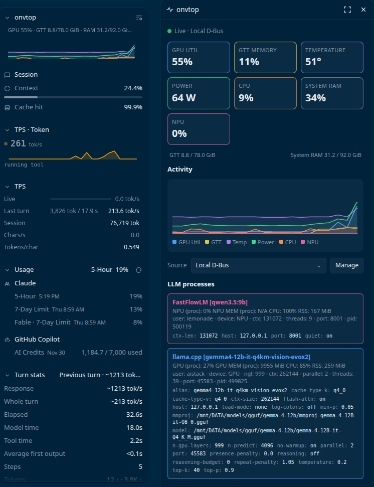

# nvstats-service

The standalone, per-user D-Bus telemetry daemon shared by GPU monitoring clients. It polls GPU/system/process data once and publishes the latest sample on the current user's session bus. The Plasma knvtop widget and OpenChamber onvtop extension are independent clients; neither contains its own sampler.

For an AI-assisted setup, point your coding agent at the [install skill](SKILL.md). Review package-manager prompts and optional privilege changes before approving them.

## APIs

**D-Bus** (per-user session bus, for knvtop/onvtop on the same machine) uses the neutral `com.daevid.nvstats` bus name, `/com/daevid/nvstats` object path, and `com.daevid.nvstats.*` interfaces:

- `Sample.Get()` returns the latest sample as a JSON string (schema below).
- `Status.IsAlive()` and `Restart()` manage the poller.
- `Process.Kill()` and `Restart()` provide process controls.

**HTTP** (optional, read-only, stdlib only; for the Vobot Mini Dock `nvtop` app and, later, remote clients):

| Endpoint | |
| --- | --- |
| `GET /health` | liveness, version, never needs the token |
| `GET /api/v1/sample` | latest sample, **minimal** view: meta + `gpu` + `sys.cpu` + top 5 `gpu_procs`; a few KB, sized for microcontrollers |
| `GET /api/v1/sample?full=1` | the full sample (`sys`, `llm`, argv arrays, ...) |
| `GET /api/v1/stream[?full=1]` | Server-Sent Events: one `sample` event per new sample (1 Hz by default, see `NVSTATS_POLL_SECONDS`), keep-alive comments in between |

Process control is **not** available over HTTP.

Sample schema (v1): meta `schema, host, seq, ts, version, git_commit`; `gpu` (one GPU, chosen with `NVSTATS_GPU_INDEX`, default 0) with `index, name, uuid, driver, backend, util, mem_util, mem_used, mem_total` (MiB), `temp, power_w, power_cap_w, fan_pct, clock_gfx, clock_gfx_max, clock_mem, clock_mem_max, pcie_gen, pcie_gen_max, pcie_width, pcie_width_max, pstate, throttle` (anything the hardware does not report is `null`); `gpu_procs[]` (`pid, name, user, vram_kb, gpu_pct, cpu_pct, cmdline`; `argv` etc. in the full view); `sys`, `llm` (llama.cpp, Ollama, vLLM, SGLang, TGI, and FastFlowLM on the NPU) in the full view. `seq` increases with every sample, so a client can detect a stale server.

**NPU (optional).** Hosts with an NPU also carry `npu`: `present, name, driver, fw, pci, readable, reason, util, util_source, tasks, tasks_max, clock_mhz, clock_max_mhz, tops, tops_max, power_w, mem_used, cmds_per_s`. On hosts without one it is `null` in the full view and absent in the minimal view, so clients draw nothing. If an NPU exists but cannot be read (no `render` group, unsupported driver), `present` is true, `readable` is false and `reason` says why; clients show N/A. Processes using the NPU appear in `gpu_procs` with `type: ["npu"]` (the marker only ever exists on NPU hosts), and NPU-backed LLM servers (FastFlowLM) appear under `llm.flm`. AMD XDNA (`amdxdna`) is supported; other drivers are detected and reported as unreadable.

`npu.util` is an activity estimate, not hardware busy time: the `amdxdna` driver exposes no utilisation counter, so it is the share of the last 2 s in which the NPU had commands in flight or completing (0 idle, ~100 while a model generates). `util_source` is `"activity"`. NPU memory is not independent: the NPU uses the same unified system RAM as the CPU and iGPU, so `sys.ram_used` already includes it; `mem_used` is only the NPU's own heap, when the driver reports it. Reading the NPU needs access to `/dev/accel/accelN` (the `render` group); the installer reports what it finds.



GPU data comes from `nvidia-smi` (NVIDIA) or sysfs plus a one-time `amd-smi static` (AMD); per-process GPU use comes from DRM fdinfo, plus `nvidia-smi --query-compute-apps` on NVIDIA, whose driver exposes no fdinfo. Set `NVSTATS_GPU_BACKEND=nvidia|amd` to force one on a host that has both.

The clients in this release use these APIs directly; there is no legacy bus-name alias.

## Install

Two modes. Both remove the old `vobot-gpu-daemon` if it is installed (`--keep-legacy` to leave it, e.g. while it still owns port 8039).

**Desktop (user session, D-Bus)** - do not run with `sudo`. Needs Python 3 with D-Bus and GLib bindings (Debian/Ubuntu/Kubuntu: `sudo apt install python3-dbus python3-gi`):

```sh
git clone https://github.com/DAE51D/nvstats-service.git
cd nvstats-service
./install.sh                                   # D-Bus only
./install.sh --http                            # + HTTP on 127.0.0.1:8039
./install.sh --http --bind 0.0.0.0 --token S3CRET   # + reachable from the LAN
./install.sh --http --poll 0.5                 # sample twice a second (for fast display clients)
```

**Headless host (system service, HTTP only - no D-Bus, no desktop session needed)**:

```sh
sudo ./install.sh --system [--bind 0.0.0.0] [--port 8039] [--token S3CRET]
```

**Starts at boot:** both modes are enabled to start at boot. User mode also runs `loginctl enable-linger` (the installer tries it, then `sudo`), because a user service otherwise only starts once you log in, so an unattended host would not answer the HTTP API after a reboot. If that step fails, run `sudo loginctl enable-linger $USER` yourself.

Settings live in an env file created once and never overwritten unless you pass the matching option (`~/.config/nvstats/nvstats.env`, or `/etc/nvstats/nvstats.env` for `--system`):

| Variable | Default | |
| --- | --- | --- |
| `NVSTATS_HTTP` | off (user mode) | `1` serves HTTP next to D-Bus |
| `NVSTATS_HTTP_BIND` | `127.0.0.1` (`0.0.0.0` with `--system`) | listen address |
| `NVSTATS_HTTP_PORT` | `8039` | |
| `NVSTATS_TOKEN` | unset | if set, `/api/v1/*` require `Authorization: Bearer <token>` |
| `NVSTATS_POLL_SECONDS` | `1` | sample interval, 0.25-10 s (`./install.sh --poll 0.5`). `gpu` and `sys` follow it; the heavier per-process and LLM data is refreshed at most once a second and reused in between (see below) |
| `NVSTATS_REDACT_ARGS` | `1` | mask values of secret-looking options (`--api-key`, `--token`, ...) in HTTP responses |
| `NVSTATS_GPU_INDEX` | `0` | which GPU to report |
| `NVSTATS_GPU_BACKEND` | auto | `nvidia` or `amd` |

Verify:

```sh
systemctl --user status nvstats.service        # or: systemctl status nvstats-httpd.service
busctl --user call com.daevid.nvstats /com/daevid/nvstats com.daevid.nvstats.Sample Get
curl http://localhost:8039/health
```

GPU tools are optional: `amd-smi`/`nvidia-smi` are used when available (NVIDIA needs `nvidia-smi`; AMD works from sysfs alone but names the card from `amd-smi`).

## Sample rate

By default the daemon samples once a second. `NVSTATS_POLL_SECONDS` (or `./install.sh --poll SECONDS`) changes that, clamped to 0.25-10 s; set it in the env file and restart the service. At a faster rate only the cheap `gpu` and `sys` readings (sysfs and `/proc`) are re-read every sample. The expensive per-process GPU scan, LLM detection and `ollama ps` still run at most once a second, so `gpu_procs` and `llm` repeat their previous values in between. `seq` and `ts` still advance on every sample. Measured on a Strix Halo box a full sample is about 50 ms of CPU, so 0.5 s adds only a few percent of one core. Hardware sensors such as temperature and power typically refresh every few hundred ms, so going below 0.25 s would add nothing.

## Optional cross-user GPU process data

The daemon can read per-process GPU engine/memory details only for processes owned by the daemon user unless its interpreter has `CAP_SYS_PTRACE`. This is optional; GPU-wide and system-wide telemetry still works without it. To grant the capability only to a dedicated Python copy, follow the cross-user GPU stats instructions in the [knvtop documentation](https://github.com/DAE51D/knvtop#cross-user-gpu-stats-per-process-gpuvram-showing-na). Do not set the capability on the system-wide Python interpreter.

## Development checks

```sh
python3 -m py_compile service/*.py backend/*.py
python3 -m unittest discover -s tests
bash -n install.sh
dbus-run-session -- python3 scripts/smoke_dbus.py
```

The D-Bus service has full access as the installing user and includes process-control methods; install it only if you trust this code. The HTTP API is read-only and off by default in user mode; it binds to loopback unless you choose otherwise. Before exposing it to a network, set `NVSTATS_TOKEN`: samples include process names and command lines (secret-looking option values are masked, but that is a best-effort filter, not a guarantee).

## Shared look (for client authors)

All the nvtop clients use the same order and colors so they read as one family. Order: GPU, GTT (memory), Temp, Power, CPU, NPU (only on hosts that report one), then system RAM, which is a gauge but not a graph line.

| Series | Color |
| --- | --- |
| GPU | `#4d9fff` |
| GTT / memory | `#e8c33a` |
| Temp | `#b07fe8` |
| Power | `#3ddc84` |
| CPU | `#ff8c42` |
| NPU | `#ec60a0` |
| System RAM | `#89929c` |

LLM engine cards: llama.cpp `#4d9fff`, Ollama `#e8c33a`, vLLM `#b07fe8`, SGLang `#3ddc84`, TGI `#ff8c42`, FastFlowLM (NPU) `#ec60a0`. NPU elements are drawn only when `npu` is present in the sample, and show N/A when it is present but unreadable.

## Other nvtop

I've leveraged this backend to display the same `nvtop` data in these projects:

- [Vobot nvtop](https://github.com/DAE51D/vobot-apps/tree/main/nvtop)
- [KDE knvtop](https://github.com/DAE51D/knvtop)
- [Openchamber onvtop](https://github.com/DAE51D/openchamber-onvtop)

So if you have this one service running those others will connect to it.
I encourage you to write other "clients" to this backend as well.